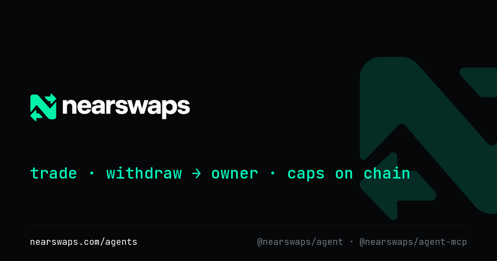
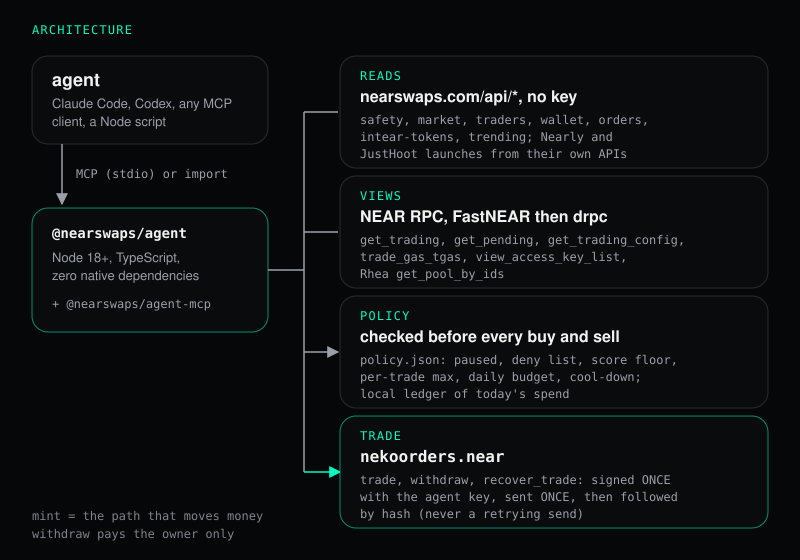

<p align="center"></p>

# nearswaps agent kit

Set a bot loose with 5 NEAR. It can trade, it can't run off with your wallet.

AI agents on other chains trade by holding a seed phrase, which means a bad prompt or a bad tool call can empty the
wallet. The nearswaps agent kit gives an agent (Claude Code, Codex, a Python bot, a Telegram bot) something smaller: a
NEAR function-call key that can call only `trade`, `withdraw` and `recover_trade` on the live 1-click contract
`nekoorders.near`, working from a 1-click balance that holds funds only you can withdraw. Two layers of limits apply.
The **hard limits** are on chain, enforced by the contract whatever the agent does. The **policy** is the kit's own
file next to the agent: a token-check score floor (with two rules beside it: not too many findings the check could
not make, not too little liquidity), a per-trade maximum, a daily budget, a deny list and a cool-down.
The kit is a Node SDK (`@nearswaps/agent`), an MCP server (`@nearswaps/agent-mcp`) and a CLI. Every agent trade pays
the normal 1-click fee.

## Try it in two minutes, no key

Read-only: no key, nothing signed, nothing sent. Each step is "do X, see Y". The output is plain text, one fact per
line, the same shape every time. The outputs below were pasted from a run on 27 Oct 2026 and trimmed where marked.

Install (Node 18 or later; the SDK has no runtime dependencies, the MCP server adds the official
`@modelcontextprotocol/sdk` and `zod`). The packages are not on npm yet, so run them from this repository:

```bash
git clone https://github.com/<org>/nearswaps-agents
cd nearswaps-agents
npm install
npm run build
npm link --workspace @nearswaps/agent --workspace @nearswaps/agent-mcp
```

`npm link` puts `nearswaps-agent` (the CLI) and `nearswaps-agent-mcp` (the MCP server) on your path. Without it, use
`node packages/agent/dist/cli.js` and `node packages/mcp/dist/bin.js` in their place.

**1. Check a token.**

```bash
nearswaps-agent check wrap.near
```

```text
token: wrap.near
score: 96
verdict: nothing dangerous found
checked at: 2026-10-27T09:20:48.988Z
finding: ok: Locked: no access keys
finding: ok: Known template: Wrapped NEAR
finding: ok: No risky methods
finding: info: One wallet can pull most of the liquidity
finding: ok: No wallet holds over 30%
finding: low: No icon
...
lp browser pass: skipped (see the README)
```

Shape: `token`, `score` (0 to 100), `verdict` (one of "nothing dangerous found", "caution", "high risk"), `checked at`,
one `finding: <severity>: <title>` line per finding (17 for `wrap.near`; shortened here), then `lp browser pass:
skipped`. It takes 5 to 10 seconds the first time; the kit keeps the answer for 60 seconds. The endpoint allows 30
requests a minute per caller, so please don't poll it.

**2. Quote a trade.**

```bash
nearswaps-agent quote near usdc 1
```

```text
side: buy
amount in: 1 NEAR
amount out: 4.409774 USDC
minimum: 4.210336 USDC (slippage 5%)
fee: 0.022159 USDC (0.5%)
venue: Rhea
price impact: 0.00%
leg 1: 1000000000000000000000000 raw in, pool 4512 wrap.near to 17208628f84f5d6ad33f0da3bbbeb27ffcb398eac501a31bd6ad2011e36133a1
quoted at: 2026-10-27T09:29:22.683Z
```

Shape: `side`, `amount in`, `amount out` (after the 1-click fee), `minimum` (the `min_out` sent to the contract, at the
slippage), `fee`, `venue` (Rhea or Intear DEX), `price impact` when known, one `leg N:` line per route leg, `quoted at`.
The price moves with the market; the shape does not.

**3. Ask an AI agent.** Add the MCP server, read-only, to Claude Code (Codex: `codex mcp add nearswaps --
nearswaps-agent-mcp --read-only`):

```bash
claude mcp add nearswaps -- nearswaps-agent-mcp --read-only
```

The server prints one line to stderr and registers eight tools, all read-only, and no money tool. A client lists:

```text
nearswaps-agent-mcp 0.1.0: read-only (no key loaded, no money tools)
get_quote, check_token, list_new_launches, list_top_traders, get_wallet, get_balance, get_pending, get_policy
```

Then ask:

```text
Which NEAR tokens launched in the last day, and what do they score?
```

The agent calls `list_new_launches` (`since_minutes: 1440`), then `check_token` for the launches it picks. Every tool
answers in JSON. Ask for a day, not an hour: in a read-only run on 27 Oct 2026 the last-hour call returned
`"launches": []` (and so did the previous two hours) with all four sources (`nearly`, `hoot`, `intear`, `shards`)
`"ok": true`. An empty window is a valid answer, and a real one. The 24-hour list, as the CLI prints it (three rows of
a longer list):

```bash
nearswaps-agent launches --since 24h --limit 3
```

```text
launch: 2026-10-26T22:58:46Z nearly nearcity.nearlytrade.near NEARCITY holders 0
launch: 2026-10-26T22:56:08Z nearly chicago.nearlytrade.near CHICAGO holders 0
launch: 2026-10-26T22:52:12Z nearly neargemini.nearlytrade.near NEARGEMINI holders 3
```

Claude Code and other Claude-based agents use the kit for research: scores, quotes, launches, balances. In a live test
on 27 Oct 2026, Claude Code with the money-mode MCP server loaded declined to call `buy` or `sell` itself and used only
the read tools. That is Claude's own policy, not a kit limit. The money tools (`buy`, `sell`, `withdraw`,
`recover_trade`) exist for agents that do place trades, such as a Node script on the SDK or another agent runtime, and
the same hard limits and policy apply to all of them. Claude-based agents can leave the buy, sell and withdraw calls to
the owner's CLI, the [prompt-driven agent](#a-prompt-driven-agent) or the [scripted agent](#a-scripted-agent). Codex
placing trades has not been tested.

Add `--json` to any CLI command for the raw result and `--color` for mint buys and red sells in a terminal that
supports it. More options, every command and every tool: [docs/reference.md](docs/reference.md).

## Let it trade

Real mainnet runs by the owner (`tome.near`): a 0.1 NEAR buy (the first on 23 Oct 2026), a sell and a withdraw. The
agent key was added with all three methods and the policy was the example below. The records are in
[docs/runs](docs/runs).

Who places the trades: the owner at the CLI (as in the runs below), the [prompt-driven agent](#a-prompt-driven-agent)
(an open model told what to do in plain language), or a scripted agent on the SDK. Claude Code, run
with the money-mode MCP server loaded, declined to call `buy` or `sell` in a test on 27 Oct 2026 and kept to research
with the read tools; that is Claude's own policy, not a kit limit. The same hard limits and policy apply to every
caller.

**Step 1. Make the agent key.** The agent makes its own key pair and prints only the public key; the pair stays in
`~/.nearswaps-agent/<account>.json` (mode 600 on macOS and Linux).

```bash
nearswaps-agent key new <account>
```

**Step 2. Add it to the account.** The owner approves one `AddKey` in their own wallet: receiver `nekoorders.near`,
methods `trade`, `withdraw` and `recover_trade`, no allowance cap. On nearswaps.com/agents that is one button; the page
is built but not published yet, so until it is, use near-cli (the owner signs with their own full-access key, which
never touches the kit):

```bash
near account add-key <account> grant-function-call-access --allowance unlimited --contract-account-id nekoorders.near --function-names trade,withdraw,recover_trade use-manually-provided-public-key <public key from step 1> network-config mainnet sign-with-keychain send
```

Then `nearswaps-agent key show <account>` says `status: On`. The kit refuses to run with any key that is not exactly
`trade`, `withdraw` and `recover_trade` on `nekoorders.near`: a full-access key in the key file is an error, not a
feature. (On Windows, NTFS ignores mode 600, so keep the kit on a machine only you use.)

**Step 3. Deposit.** The owner deposits NEAR into the 1-click balance in the Terminal (nearswaps.com/terminal, 1-click
tab, Deposit). The agent cannot deposit: `deposit_trading` takes an attached deposit, which a function-call key cannot
send. `nearswaps-agent balance` shows the balance, and every trade checks it first (the refusal below read 0.777503
NEAR in the 1-click balance).

### The policy

**Step 4. Write the policy.** `nearswaps-agent policy init` writes this example to `~/.nearswaps-agent/policy.json`;
`nearswaps-agent policy show` prints it with today's spend.

```json
{
  "paused": false,
  "deny": [],
  "trusted": [
    "17208628f84f5d6ad33f0da3bbbeb27ffcb398eac501a31bd6ad2011e36133a1",
    "usdt.tether-token.near",
    "wrap.near"
  ],
  "min_score": 70,
  "max_unchecked": 3,
  "min_liquidity_near": 100,
  "max_trade_near": 1,
  "daily_budget_near": 3,
  "cooldown_sec": 600,
  "slippage_bps": 500
}
```

| Field | What it does |
|---|---|
| `paused` | `true` stops every buy and sell; withdrawals still work |
| `deny` | token ids the agent never buys |
| `trusted` | token ids whose buys skip the three token-check rules (`min_score`, `max_unchecked`, `min_liquidity_near`), and only those: the deny list and every other rule still apply |
| `min_score` | the least token-check score (0 to 100) a token needs for a buy |
| `max_unchecked` | the most "could not check" findings the token check may have for a buy. A check the server couldn't make costs the score nothing, so an empty launch can score 80; on 27 Oct three Nearly launches with 0 NEAR of liquidity did |
| `min_liquidity_near` | the least liquidity, in NEAR, the token check must find for a buy; no figure counts as 0, and the result says so. 0 turns the rule off |
| `max_trade_near` | the most NEAR one buy may spend |
| `daily_budget_near` | the most NEAR traded per UTC day |
| `cooldown_sec` | seconds after a trade in a token before the next trade in that token |
| `slippage_bps` | `min_out` is the quote less this (500 = 5%), or `"auto"` |

Every field is required; a missing or unknown field is an error, never a silent default. The one exception: a file
written before `max_unchecked` and `min_liquidity_near` existed (27 Oct 2026) still loads, takes their defaults (3
and 100) and says so in one line on stderr; add the two fields to choose. The order the rules run in is in
[docs/reference.md](docs/reference.md). `nearswaps-agent policy check buy <token> <near>` is a dry run: each rule,
pass or fail, nothing signed.

These runs were made on 23 Oct 2026, before the policy had `max_unchecked` and `min_liquidity_near`. A buy now lists
`check max_unchecked` and `check min_liquidity_near` right after `check score_floor` (for BLACKDRAGON on 27 Oct: one
finding the check could not make and 13,210 NEAR of liquidity, so both pass); a sell lists both as `skip`.

**Step 5. The first buy: a refusal, before anything is signed.** The owner ran this with 0.194709 NEAR free in the
wallet itself. Each trade reserves gas there for a few seconds, so the kit stopped, listed every check, and signed
nothing:

```bash
nearswaps-agent buy blackdragon 0.1 --account tome.near
```

```text
outcome: blocked
reason: keep at least 0.21 NEAR free in the owner's wallet tome.near itself (not the 1-click balance) for this
        trade's network fee reserve; almost all of it comes back within seconds. The wallet has 0.194709 NEAR free
score: 80
check venue: pass (trades on Rhea)
check balance: pass (0.777503 NEAR in the 1-click balance)
check paused: pass
check deny_list: pass
check score_floor: pass (score 80 (caution) meets the floor of 70)
check max_trade_near: pass (0.1 NEAR is within the per-trade maximum of 1 NEAR)
check daily_budget_near: pass (0 NEAR traded today (UTC); 0.1 NEAR with this trade, within 3 NEAR)
check cooldown_sec: pass (no earlier trade in blackdragon.tkn.near)
check contract_caps: pass (within the contract's max_trade_wnear of 10000 NEAR)
check gas_reserve: fail
```

A `blocked` result is the kit working: the rule that stopped it is named, and nothing was sent. The owner then sent
1 NEAR to the wallet and ran the same command again.

**Step 6. The same buy, filled.** [Transaction on NearBlocks](https://nearblocks.io/txns/CjetygCtZzcM1LZq49ZznVKW4d3ftQnxDSqnQjMgcmP1).

```text
outcome: filled
tx: CjetygCtZzcM1LZq49ZznVKW4d3ftQnxDSqnQjMgcmP1   (nearblocks.io/txns/CjetygCtZzcM1LZq49ZznVKW4d3ftQnxDSqnQjMgcmP1)
contract event: trade id 44, venue rhea, wrap.near -> blackdragon.tkn.near
amount in:  0.1 NEAR
amount out: 44,056,878.29046 BLACKDRAGON
fee: 25 bps (110,418.24 BLACKDRAGON to nekotesting.near; the owner's Feline-staker discount halves the 50 bps fee)
gas burnt: 25.67 Tgas, 0.00241 NEAR, paid from the owner's wallet
```

Afterwards the 1-click balance held 0.52 NEAR and 44,056,878.29046 BLACKDRAGON. Selling is the same call the other way;
this one sold half of that BLACKDRAGON balance, and a sell is never blocked by the score:
[transaction on NearBlocks](https://nearblocks.io/txns/E1JVrAa7qAFftCVZRfoLdyQiq5qetsiSdZRkPAL4Dbo3).

```text
outcome: filled
reason: sold blackdragon.tkn.near on Rhea
amount in: 22,028,439.14523 BLACKDRAGON
amount out: 0.032718 NEAR
fee: 0.000082 NEAR
tx: https://nearblocks.io/txns/E1JVrAa7qAFftCVZRfoLdyQiq5qetsiSdZRkPAL4Dbo3
check venue: pass (trades on Rhea)
check balance: pass (44,056,878.29046 BLACKDRAGON in the 1-click balance)
check paused: pass (the policy is not paused)
check deny_list: skip (not applied to sells)
check score_floor: skip (not applied to sells)
check max_trade_near: skip (not applied to sells)
check daily_budget_near: pass (0 NEAR traded today (UTC); 0.0328 NEAR with this trade, within 3 NEAR)
check cooldown_sec: pass (the last trade in blackdragon.tkn.near was more than 600 s ago)
check contract_caps: pass (within the contract's max_trade_wnear of 10000 NEAR (a sell is valued at the expected NEAR out); max_trading_wnear 10000 NEAR caps the 1-click balance at deposit)
```

**Step 7. Withdraw.** The NEAR comes back to the owner's wallet. `withdraw` has no recipient argument, so the agent
cannot name one. [Transaction on NearBlocks](https://nearblocks.io/txns/HVs7G59awi7DQZ6Yt7TSF5hcyVxjRANbcvEjFiwv6bSs).

```bash
nearswaps-agent withdraw near --account tome.near
```

```text
outcome: filled
reason: NEAR sent to tome.near as NEAR
amount in: 0.552718 NEAR
amount out: 0.552718 NEAR
tx: https://nearblocks.io/txns/HVs7G59awi7DQZ6Yt7TSF5hcyVxjRANbcvEjFiwv6bSs
check withdraw_to_owner: pass (the contract pays tome.near only: withdraw has no recipient argument)
```

If a trade stops part way, `nearswaps-agent pending` lists it and `nearswaps-agent recover <id>` carries it on once it
is recoverable (about an hour after its last step); the result is `filled` or `pending` with what to do next. Every
money call returns one shape and never throws: `outcome` (`filled`, `refused`, `blocked`, `unclear` or `pending`),
`reason`, `tx`, amounts, `fee`, `score` and every check. Each key-signed call is signed once and sent once, then followed
by its hash, so a trade can't happen twice. Details: [docs/reference.md](docs/reference.md).

## A prompt-driven agent

[examples/prompt-agent.mjs](examples/prompt-agent.mjs) trades from a plain-language prompt. It runs a tool-calling
loop against an OpenAI-compatible chat completions endpoint, by default NEAR AI Cloud (`https://cloud-api.near.ai/v1`,
open models running in TEEs), with the kit's twelve tools taken from the MCP server itself, so the tools the model sees
and the tools `nearswaps-agent-mcp` serves are the same code. Claude-based agents use the research tools and leave
trading to this runner, the [scripted agent](#a-scripted-agent) or the owner's CLI.

**Setup.** Make a NEAR AI Cloud key: sign in at [cloud.near.ai](https://cloud.near.ai), add credits under Credits, and
generate a key under API Keys. Put it in `~/.nearswaps-agent/llm.json`, next to the agent key and outside the repo:

```json
{ "base_url": "https://cloud-api.near.ai/v1", "api_key": "<your NEAR AI Cloud key>", "model": "z-ai/glm-5.3-flash" }
```

or set `NEARSWAPS_LLM_API_KEY` (and, for another OpenAI-compatible endpoint, `NEARSWAPS_LLM_BASE_URL`); the
environment wins over the file, and `--model` over both. Without a model in either, it uses `z-ai/glm-5.3-flash`, an
open model NEAR AI Cloud serves itself with tool calling (`curl https://cloud-api.near.ai/v1/models` lists the rest,
with `tools` among each model's `supported_features`). The key is read, never printed. Then:

```bash
node examples/prompt-agent.mjs --account <account> "buy 0.2 NEAR of the best token that launched today scoring over 70, then show my balance" --dry-run
```

Drop `--dry-run` for a real run with the agent key (steps 1 to 3 of [Let it trade](#let-it-trade) first). Flags:
`--max-steps <n>` (default 12), `--max-money <n>` (default 2), `--model <id>`, `--policy <file>`, `--color`.

What holds in code, whatever the model says:

- at most `--max-steps` model turns, then the run stops with no answer;
- at most `--max-money` money calls (`buy`, `sell`, `withdraw`, `recover_trade`) a run; the next one is not sent;
- a buy or sell the policy blocked is not sent again in the same run, and the model is told so;
- every money call goes through the policy and the contract, through the same handlers as the MCP server;
- without `--dry-run`, the loop does not start unless the agent key file is there.

The system prompt adds the kit's vocabulary and four rules: check the token and quote before a buy, never retry a
blocked trade, stop when the request is met, report every outcome with its tx hash. `--dry-run` loads no key and
signs nothing: `buy` and `sell` run the policy's dry run (`would pass` or `blocked`), `withdraw` and `recover_trade`
return a note. Each step prints one fact per line: the model's tool call with its arguments, the tool's result (money
results in full, read results trimmed to a line) and the model's final answer.

The transcript below is the test's dry run (`examples/prompt-agent.test.mjs`): a scripted OpenAI-compatible server
in place of the model and the kit's fake chain, with USDC standing in as a launch of the day. It shows the shape of a
run, not a live one; the temporary paths and the server's port are shortened.

```text
mode: dry run (no key loaded; nothing signed)
account: agent-demo.near
policy: <test home>/.nearswaps-agent/policy.json
model: test/model at http://127.0.0.1:<port>/v1
most steps: 12
most money calls: 2
prompt: buy 0.2 NEAR of the best token that launched today scoring over 70, then show my balance
step 1: call list_new_launches {"since_minutes":1440}
step 1: result: { "launches": [ { "id": "17208628f84f5d6ad33f0da3bbbeb27ffcb398eac501a31bd6ad2011e36133a1", "pad": "intear", "symbol": "172086", "name": "17208628f84f5d6ad33f0da3bbbeb27ffcb398eac501a31bd6ad2011e36133a1", "created": 1793610000000, "mc_usd": ... (489 more characters)
step 2: model: Two launches today. Checking both.
step 2: call check_token {"token":"17208628f84f5d6ad33f0da3bbbeb27ffcb398eac501a31bd6ad2011e36133a1"}
step 2: result: { "token": "17208628f84f5d6ad33f0da3bbbeb27ffcb398eac501a31bd6ad2011e36133a1", "score": 88, "verdict": "nothing dangerous found", "checked_at": "2026-11-02T12:00:00Z", "findings": [], "unchecked": 0, "liquidity_near": 5000, "cached": false, ... (43 more characters)
step 2: call check_token {"token":"ftv2.nekotoken.near"}
step 2: result: { "token": "ftv2.nekotoken.near", "score": 30, "verdict": "high risk", "checked_at": "2026-11-02T12:00:00Z", "findings": [], "unchecked": 0, "liquidity_near": 5000, "cached": false, "note": "", "lp_browser_pass": "skipped" }
step 3: call get_quote {"from":"near","to":"17208628f84f5d6ad33f0da3bbbeb27ffcb398eac501a31bd6ad2011e36133a1","amount":"0.2"}
step 3: result: { "from": "wrap.near", "to": "17208628f84f5d6ad33f0da3bbbeb27ffcb398eac501a31bd6ad2011e36133a1", "amount_in": "0.2 NEAR", "amount_out": "0.984144 USDC", "min_out": "0.939634 USDC", "fee": "0.004945 USDC", "fee_bps": 50, "slippage_bps": 500, ... (1010 more characters)
step 4: call buy {"token":"17208628f84f5d6ad33f0da3bbbeb27ffcb398eac501a31bd6ad2011e36133a1","near":"0.2"}
step 4: side: buy
step 4: token: 17208628f84f5d6ad33f0da3bbbeb27ffcb398eac501a31bd6ad2011e36133a1
step 4: near: 0.2 NEAR
step 4: outcome: would pass
step 4: reason: every policy rule passes; the 1-click balance and the gas reserve are checked when the trade runs
step 4: score: 88
step 4: signed: nothing (a dry run)
step 4: check paused: pass (the policy is not paused)
step 4: check deny_list: pass (not on the deny list)
step 4: check score_floor: pass (score 88 (nothing dangerous found) meets the floor of 70)
step 4: check max_unchecked: pass (0 "could not check" findings, within the most of 3)
step 4: check min_liquidity_near: pass (5000 NEAR of liquidity, at or above the least of 100 NEAR)
step 4: check max_trade_near: pass (0.2 NEAR is within the per-trade maximum of 1 NEAR)
step 4: check daily_budget_near: pass (0 NEAR traded today (UTC); 0.2 NEAR with this trade, within 3 NEAR)
step 4: check cooldown_sec: pass (no earlier trade in 17208628f84f5d6ad33f0da3bbbeb27ffcb398eac501a31bd6ad2011e36133a1)
step 4: check contract_caps: pass (within the contract's max_trade_wnear of 10000 NEAR; max_trading_wnear 10000 NEAR caps the 1-click balance at deposit)
step 5: call get_balance {}
step 5: result: { "account": "agent-demo.near", "balances": [ { "token": "wrap.near", "amount": "2 NEAR", "raw": "2000000000000000000000000", "here": "2000000000000000000000000", "rhea": "0", "intear": "0" } ], "wallet_free": "5 NEAR" }
answer: The best launch today scoring over 70 is 17208628f84f5d6ad33f0da3bbbeb27ffcb398eac501a31bd6ad2011e36133a1 (USDC, score 88).
answer: buy: would pass (a dry run; nothing signed, no tx)
answer: 1-click balance: 2 NEAR
money calls this run: 1 of at most 2
```

The tests also cover a filled buy (the tx hash in the result, the line and the answer), a blocked buy the model then
tries again (not sent), the step cap and the money-call cap. No run against a live model is recorded here yet.

## A scripted agent

[examples/trench-bot.mjs](examples/trench-bot.mjs) is an agent written on the SDK, the one in the demo video. It
lists the launches of the last day across Shards, Nearly, JustHoot and Intear, runs the token check on at most 10 of
them (one at a time, the 60 s cache answering repeats), prints one line per token, buys the best one the policy
allows with the agent key, then tries the lowest-scoring one at the same amount so a refusal shows on screen, and
ends with the 1-click balance.

```bash
node examples/trench-bot.mjs --dry-run --account <account> --token blackdragon --refuse tear
```

`--dry-run` loads no key and signs nothing: each buy becomes a dry run of the policy (the same rules, in the same
order), printed as `would pass` or `blocked`. Without it the buys are real and need `--account` and the agent key.
Flags: `--since <minutes>` (default 1440), `--amount <NEAR>` (default 0.2), `--token <id>` and `--refuse <id>` to
choose the buy and the refusal instead of the launch list, `--policy <file>`, `--color`.

Most new launches are Nearly and JustHoot tokens on Rhea DCL, which the kit reads but does not trade (it trades on
Rhea and Intear DEX), so on a day with no Rhea or Intear launch the bot finds nothing to buy and its refusal is the
kit's venue check, not the policy. `--token` and `--refuse` are for that day. The output of a dry run on 27 Oct 2026
with the example policy (trimmed where marked):

```text
mode: dry run (no key loaded; nothing signed)
policy: ~/.nearswaps-agent/policy.json
score floor: 70
most unchecked findings: 3
least liquidity: 100 NEAR
per-trade maximum: 1 NEAR
amount per buy: 0.2 NEAR
launches in the last 1440 minutes: 26
token checks this run: 10 (at most 10)
token: blackdragon.tkn.near | launchpad chosen | age chosen | liquidity 13,210.2 NEAR | score 80 | unchecked 1 | verdict caution | 1-click yes
token: token.intear.near | launchpad chosen | age chosen | liquidity 15,033.33 NEAR | score 50 | unchecked 0 | verdict caution | 1-click yes
token: eaglewolf4.nearlytrade.near | launchpad nearly | age 2h 8m | liquidity 16.51 NEAR | score 20 | unchecked 2 | verdict high risk | 1-click no
token: drita.nearlytrade.near | launchpad nearly | age 7h 56m | liquidity 6.72 NEAR | score 20 | unchecked 2 | verdict high risk | 1-click no
(6 more Nearly rows, 1-click no)
buy: blackdragon.tkn.near (score 80)
side: buy
token: blackdragon.tkn.near
near: 0.2 NEAR
outcome: would pass
reason: every policy rule passes; the 1-click balance and the gas reserve are checked when the trade runs
score: 80
signed: nothing (a dry run)
check paused: pass (the policy is not paused)
check deny_list: pass (not on the deny list)
check score_floor: pass (score 80 (caution) meets the floor of 70)
check max_unchecked: pass (1 "could not check" finding, within the most of 3: who holds the rest of the LP)
check min_liquidity_near: pass (13210.2 NEAR of liquidity, at or above the least of 100 NEAR)
check max_trade_near: pass (0.2 NEAR is within the per-trade maximum of 1 NEAR)
check daily_budget_near: pass (0 NEAR traded today (UTC); 0.2 NEAR with this trade, within 3 NEAR)
check cooldown_sec: pass (no earlier trade in blackdragon.tkn.near)
check contract_caps: pass (within the contract's max_trade_wnear of 10000 NEAR; max_trading_wnear 10000 NEAR caps the 1-click balance at deposit)
refusal test: token.intear.near (score 50)
side: buy
token: token.intear.near
near: 0.2 NEAR
outcome: blocked
reason: score 50 (caution) is below the floor of 70
score: 50
signed: nothing (a dry run)
check paused: pass (the policy is not paused)
check deny_list: pass (not on the deny list)
check score_floor: fail (score 50 (caution) is below the floor of 70)
(the 6 rules after it: skip, an earlier rule blocked the trade)
stopped by: score_floor (the policy)
account: tome.near
1-click balance: 22,028,439.14523 BLACKDRAGON
1-click balance: 0.5 NEAR
wallet free for gas: 1.261246 NEAR
```

## What the key can and cannot do

Can, with its key and no human present:
- Read anything public: quotes, token check scores and findings, new launches, top traders, any wallet's record,
  the chart data, open orders, its own 1-click balance and pending trades.
- `trade` from the owner's 1-click balance: buy a token with NEAR, sell a token for NEAR, on Rhea pools the
  contract allows or Intear DEX, with its own `min_out` from a slippage setting.
- `withdraw` the balance back to the owner's wallet (never anywhere else; the contract has no recipient argument).
- `recover_trade` on a trade that stopped part way (anyone may call it; it is the key's third method, decided 22 Oct after
  session 1 found the two-method key could not call it).

Cannot, by construction (a function-call key cannot attach a deposit, and the key names three methods only):
- Deposit into the 1-click balance (`deposit_trading` is payable). The human deposits in the Terminal.
- Place auto orders (`ft_transfer_call` needs 1 yoctoNEAR). Stops and limits stay a human step in the Terminal.
- Make a NEAR Intents deposit for a cross-chain exit (an `ft_transfer`). The SDK can fetch the quote and hand the
  human a ready link; the human signs.
- Touch any other contract, token or account, or the owner's other keys.

Costs the owner must know: gas for each trade comes out of the owner's NEAR balance (the key has no fee cap, by
design since v1.6); the 1-click fee per trade as in the Terminal. Agent trades earn no nearswaps points today.

## Hard limits versus policy

| Hard limits (the contract, on chain) | Policy (the kit, where the agent runs) |
|---|---|
| The agent key calls `trade`, `withdraw` and `recover_trade` on `nekoorders.near`, nothing else | Score floor from the token check, with a trusted list |
| | At most `max_unchecked` "could not check" findings in the token check |
| | At least `min_liquidity_near` NEAR of liquidity in the token check |
| `withdraw` pays the owner only; there is no recipient argument; `recover_trade` only ever credits the owner | Per-trade maximum in NEAR |
| Trades only through pools and venues the contract allows, against tokens switched on for 1-click | Daily budget per UTC day |
| `max_trade_wnear` per trade, `max_trading_wnear` per 1-click balance | Deny list |
| A pause switch for trading (withdrawals always work) | Cool-down per token |
| A function-call key can't attach NEAR: no deposits, no auto orders, no transfers | A paused flag |

`nekoorders.near` still holds its keys (the lock step has not been run) and the fee wallet's key rotation is open: the
contract can still be upgraded by its owner. The policy file is the kit's own and is enforced where the agent runs: an
agent with shell access can edit it, which is why the hard limits are the ones to rely on.

## Architecture

<p align="center"></p>

- **Reads** use the public endpoints on nearswaps.com as they are; no new backend.
- **Routing** is a port of the site's route code over the contract's allowed pools; the test suite compares its route
  and `min_out` with ten routes recorded read-only from the live Terminal.
- **Gas** comes from the contract's `trade_gas_tgas`, never a constant.
- **Signing** follows the Terminal's own pattern: sign once, send once, follow by hash. Money calls on one agent run
  one at a time, so two at once can't pass the daily budget twice or share a nonce.
- **The MCP server** puts `readOnlyHint` on the read tools and `destructiveHint` on `buy`, `sell` and `withdraw`;
  `--read-only` loads no key and registers no money tool.
- **Tests**: `npm test` runs 91 offline tests from recorded fixtures; `npm run smoke` is live and read-only (CI runs it).

## Built for NEAR HACKATHON 2026

Tracks: **AI Security & Defense**, **Agent Economy**, **Unstoppable DeFi**.

Predates the hackathon: the `nekoorders.near` contract and its 1-click trading, the nearswaps.com site and its read
endpoints, the token check, the keeper and the backend. Built from 22 Oct 2026 onward: this SDK (first commit 22 Oct),
the MCP server and CLI (23 Oct), the nearswaps.com/agents page (built 23 Oct, not yet published when this was
written) and these docs (27 Oct). The hackathon's submission window is 1 to 14 Nov 2026, so the first of this work
was written before the window opened; none of the contract, the site or the backend was built for it. The mainnet runs
above are real trades from the owner's own wallet.

`nekoorders.near` still holds its keys, and the fee wallet's key rotation is open: the contract can still be upgraded
by its owner. The code hash on chain on 27 Oct 2026 (block 221808043) was `7PyDr1xeswTWarWdvDhJm97NDJUdCJYyYpDbcAzLFfW7`;
read it yourself:

```bash
curl -s -X POST https://free.rpc.fastnear.com -H 'content-type: application/json' -d '{"jsonrpc":"2.0","id":1,"method":"query","params":{"request_type":"view_account","finality":"final","account_id":"nekoorders.near"}}'
```

or open [nekoorders.near on NearBlocks](https://nearblocks.io/address/nekoorders.near).

## Licence

MIT for the kit in this repository (see [LICENSE](LICENSE)). The contract's source is not in this repository: its code is
on chain at `nekoorders.near`, identified by the hash above.

## Links

- nearswaps.com
- nearswaps.com/agents (where the owner adds and removes the agent key)
- The Terminal: nearswaps.com/terminal
- The token check: nearswaps.com/check
- [docs/reference.md](docs/reference.md), [SECURITY.md](SECURITY.md), [CONTRIBUTING.md](CONTRIBUTING.md)
